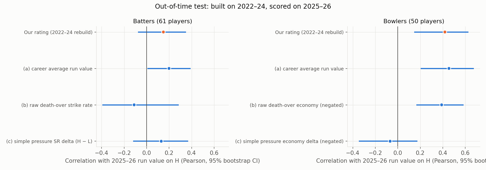
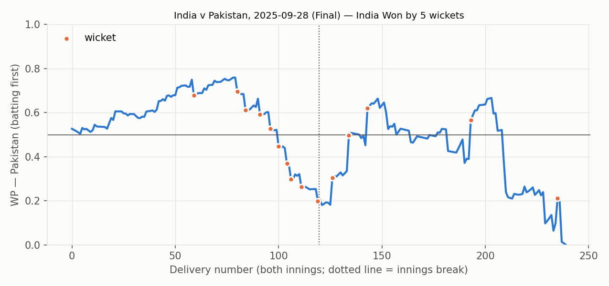
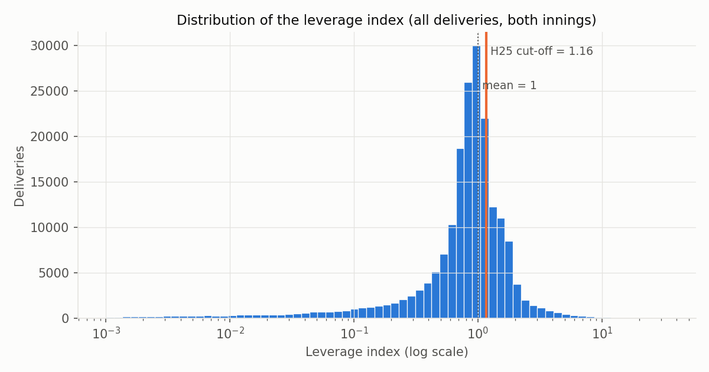
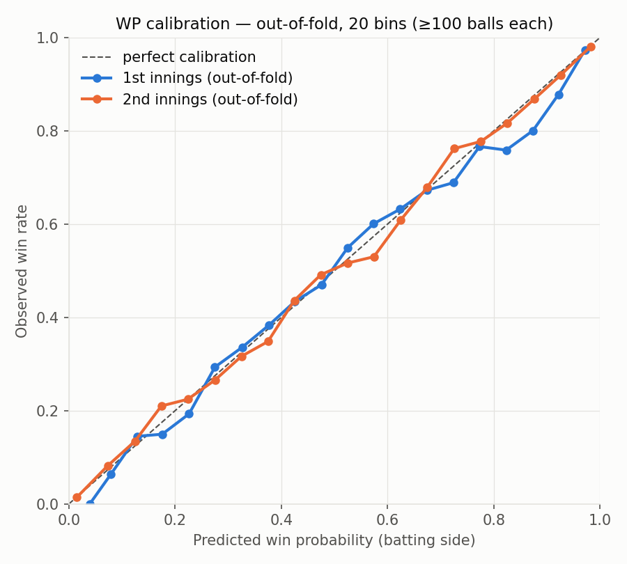

# Proven Under Pressure

**Ranking the most reliable T20 batters and bowlers under pressure, SupeRR Selector Season 2, Round 1.**

## The idea

A win-probability model prices every delivery in 843 men's T20 matches (2022–2026, IPL and T20I). A Leverage Index measures how much each ball could swing the result, and the top 25% of leverage within each innings forms the pressure set. Every ball is scored against what was expected given the match state, venue, competition strength and the quality of the opponent faced. Players are then rated with an empirical Bayes model of their run value on pressure deliveries, which weighs each player's own pressure record only as far as the data support it.

## Final top 10

Ratings are runs per 100 high-leverage balls relative to expectation; the full lists with ratings, uncertainty, tiers and the next 10 are in `outputs/tables/locked_top10_batters.csv` and `outputs/tables/locked_top10_bowlers.csv`.

| Rank | Batters | Bowlers |
|---:|---|---|
| 1 | Vaibhav Sooryavanshi | Jasprit Bumrah |
| 2 | Abhishek Sharma | Sunil Narine |
| 3 | Finn Allen | Matheesha Pathirana |
| 4 | Phil Salt | Nathan Ellis |
| 5 | Suryakumar Yadav | Rashid Khan (Afghanistan) |
| 6 | Tim David | Eshan Malinga |
| 7 | Heinrich Klaasen | Josh Hazlewood |
| 8 | Andre Russell | Bhuvneshwar Kumar |
| 9 | Travis Head | Mujeeb Ur Rahman |
| 10 | Priyansh Arya | Varun Chakravarthy |

## Key finding



Built on 2022–24 and tested on 2025–26, the standard pressure economy delta (economy under pressure minus economy otherwise) predicts bowlers' future pressure performance at **r = −0.07**; our rating predicts it at **r = 0.42**. A plain career average does about as well (r = 0.46), which is the wider lesson of the study: core skill is the best predictor of pressure performance, and raw pressure splits are mostly noise.

## How pressure is measured



Win probability for the team batting first, ball by ball, in the 2025 Asia Cup final (India v Pakistan).



```
LI_raw = Σ_o p(o | s) · | WP(s_o) − Σ_o' p(o' | s) · WP(s_o') |
LI     = LI_raw / mean(LI_raw)

o   = outcome of the ball (0, 1, 2, 3, 4, 6, wicket, wide/no-ball)
s   = match state before the ball;  s_o = state after outcome o
p   = player-agnostic outcome model;  WP = batting side's win probability (ties = 0.5)
Pressure set H = top 25% of LI within each innings
```

## Does it hold up?



The win-probability model is well calibrated out of fold in both innings. Batting process measures under pressure repeat for the same player (split-half reliability, mean of 50 random match splits, Spearman–Brown corrected):

| Batting process metric on pressure balls | Reliability | 95% interval |
|---|---:|---|
| Boundary elevation | 0.45 | 0.29 – 0.58 |
| Strike-rate delta | 0.43 | 0.26 – 0.55 |
| Dot suppression | 0.42 | 0.26 – 0.54 |

## How to reproduce

Place the six data pack CSVs in the project root: `ball_by_ball.csv`, `matches.csv`, `competitions.csv`, `teams.csv`, `playing_eleven.csv`, `competition_team_player_mapping.csv`. Then run:

```bash
python3 -m venv .venv
.venv/bin/pip install -r requirements.txt
.venv/bin/python run_all.py
```

The pipeline runs nine stages end to end, with 40+ automated checks after the stages (stopping on any failure), and a fixed seed of 42, so every output is reproducible.

## Repository layout

| Path | Contents |
|---|---|
| `src/` | Pipeline modules, one per stage, plus `checks.py` |
| `run_all.py` | Runs all nine stages and the checks in order |
| `outputs/` | Stage reports, tables, charts and player cards |
| `outputs/FINAL.md` | Complete write-up: definitions, formulas, results, validation and limitations |
| `DECISIONS.md` | Every analysis decision and the reason for it |

Pipeline stages:

1. Data audit and cleaning
2. Win-probability model and endgame study
3. Pressure: Leverage Index and the pressure set
4. Per-ball performance value against expectation and opponent quality
5. Pressure metrics and role tags
6. Repeatability, targets and signal-recovery tests
7. Rating and ranking
8. Validation (out of time, knockouts, face validity)
9. Team-fit layer, player cards and the final report
